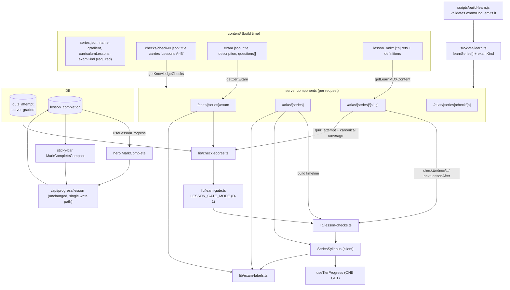

# Architecture — Learn lesson IA (citations, milestone timeline, sticky completion) + exam naming kind

**Task:** t_47db5c5e (brainiac, architect)
**Deliverables:** `architecture.md` (this file), `api-contracts.md`, `cards.md` (19 cards)
**Requirements:** `Fortress-of-Solitude/requirements/adroit-site-learn-ux-exam-naming-2026-10-25.md`
(Part 1 Chris brief, Part 2 BA analysis, Amendment 1 desktop **and** mobile)
**Repo:** `/Users/kelex/Documents/Projects/adroit-code` @ `93198b82` (origin/main), tenant `adroit`
**Status:** decision-ready blueprint. Implementation → Steel cards; UI/UX → Kara cards. No code in this document is production code.

---

## 0. What this document decides

The BA left five decisions for the architect (section 6 of the requirements: label source location and
`examKind` plumbing for Workstream B; MDX body/sources split and lesson→check mapping helper for
Workstream A). Everything below answers those, plus the two things the requirements did not settle:
how the D-1 gate is switched without rework, and how the series page stops issuing a second progress
fetch.

**Not decided here (and deliberately):** D-1 (lesson gating semantics), D-2 (`agentic-ai` kind),
D-3 (pass mark for course-completion exams). Section 4 designs a single switch for D-1 and states the
default assumed. D-2 and D-3 are content/product answers, not architecture.

**Verified before designing** (probes run against the real repo, outputs in §3.1 and §7.3):

| Claim from the requirements | Verified? | What the repo actually does |
|---|---|---|
| Citations are GFM footnotes, not a component | ✅ | `remark-gfm` emits `<section data-footnotes>` as a sibling of the body; `MDXArticle` only renames its `<h2>` to "Sources" |
| The footnote block can be split out of the MDX render | ⚠️ partially | A definitions-only MDX document renders **nothing** — the section is emitted only when the document *also* contains references. The split needs both passes to render the whole document with a rehype filter. See §3.1 |
| `group` in `series.json` is not a runtime value | ✅ | `build-learn.js:236`, `src/data/learn.ts` has no `group`, `lib/learn.ts:69-70` sets `group: null` |
| Milestone check ranges come from each check file's title | ✅ | `lib/quiz.ts:112-142` (`/Lessons\s+(\d+)\s*[–-]\s*(\d+)/`), never `5n` |
| No lesson-level gating exists | ✅ | `LessonNavigation` links next unconditionally; only the exam and certificate are gated |
| Two exam surfaces already fetch `/api/progress/quiz/tiers` | ✅ (new) | `CheckCardList` and `ExamCard` each issue the **same** GET on `/atlas/[series]` — two identical requests per series page |
| Every lesson has sources | ✅ (new) | 510 of 510 `content/learn/*/*.mdx` files carry `[^n]:` definitions |
| No duration field in `exam.json` | ✅ (new) | 105 minutes is hardcoded in 4 surfaces; question count is `exam.questions.length` |

---

## 1. Stack and topology (unchanged)

Next.js App Router on Vercel-class hosting, TypeScript, server components for every lesson/series/exam
surface, Tailwind with CSS-variable tokens in dark mode, vitest + testing-library for unit/component
tests, `scripts/build-learn.js` as the content→module generator.

This release adds **no** new runtime, service, data store, or write path. Two new lib modules, one new
client hook, four new components, one retirement. That is the whole surface.

---

## 2. Component map

### 2.1 New / changed modules (Workstream A)

```
src/lib/lesson-sources.ts                 NEW  server-only: hasFootnoteDefinitions(mdx)
src/components/MDX/footnote-plugins.ts    NEW  shared rehype: rename Footnote->Sources, drop section, keep-only section
src/components/MDX/MDXArticle.tsx         EDIT optional sources={ "inline" | "split" } (default "inline")
src/components/MDX/MDXSources.tsx         NEW  renders ONLY the sources section; null when none
src/lib/lesson-checks.ts                  NEW  pure: timeline builder + lesson<->check mapping + check state
src/lib/learn-gate.ts                     NEW  pure: LESSON_GATE_MODE switch + resolveLessonGate()
src/lib/check-scores.ts                   NEW  server: quiz_attempt -> per-check scores (extracted from exam page)
src/lib/hooks/useTierProgress.ts          NEW  client: ONE /api/progress/quiz/tiers request per series
src/components/Progress/CheckTimelineNode.tsx  NEW  milestone row in the syllabus (state badge + 44px target)
src/components/Learn/MilestonePanel.tsx   NEW  end-of-range panel on a lesson ("Next: Knowledge Check 1")
src/components/Learn/SeriesSyllabus.tsx   EDIT interleave check nodes; sort + hide rules
src/components/Learn/LessonNavigation.tsx EDIT optional nextOverride (route into a check)
src/components/Progress/QuizWidget.tsx    EDIT optional continueHref/continueLabel on the results view
src/app/atlas/[series]/page.tsx           EDIT drop <CheckCardList>, pass checks into the syllabus
src/app/atlas/[series]/[slug]/page.tsx    EDIT composition order + milestone resolution + sticky slot
src/app/atlas/[series]/check/[n]/page.tsx EDIT pass continue target; use check-scores module
```

Retired: `src/components/Progress/CheckCardList.tsx` (its section is exactly what Item 2 removes; the
row visual moves into `CheckTimelineNode`). Nothing else imports it — verified by grep.

### 2.2 New / changed modules (Workstream B)

```
content/learn/<series>/series.json         EDIT 12 files: "examKind": "certification-prep" | "course-completion"
scripts/build-learn.js                     EDIT validate examKind (fail the build when absent/invalid), emit it
src/data/types.ts                          EDIT ExamKind union; LearningSeries.examKind: ExamKind
src/lib/exam-labels.ts                     NEW  THE label source (client-safe, no fs)
src/lib/exam-config.ts                     NEW  CERT_EXAM_MINUTES = 105 (one home for the hardcoded duration)
content/learn/<series>/exam.json           EDIT 12 titles -> "<Series name>: <kind label>"
src/components/Progress/ExamCard.tsx       EDIT kind + counts as props; meta from labels
src/components/Progress/ExamLocked.tsx     EDIT kind + totals as props; "all 9" becomes "all {total}"
src/components/Progress/ExamWidget.tsx     EDIT kind as prop; 72 -> CERT_EXAM_PASS_PCT
src/components/Progress/Certificate.tsx    EDIT kind as prop; cert copy from labels
src/components/Progress/GuestCTA.tsx       EDIT exam/certificate tiers take kind + counts
src/app/atlas/[series]/exam/page.tsx       EDIT head + guest/authed headers from labels
src/app/atlas/[series]/certificate/page.tsx EDIT copy + SEO from labels
src/lib/sky.ts                             EDIT chronicleLabel takes examKind; never claims "cert prep" unknowingly
```

**Hard boundary:** `src/lib/learn.ts` imports `fs`. No client component may import it. Therefore the
label source (`exam-labels.ts`) contains **no** series data and **no** inference — it maps a `kind`
value to copy. The kind is resolved server-side (`getSeriesBySlug(slug)!.examKind`) and passed down as
a prop. This is what keeps one source of truth from becoming a second client-side map (the ADR-221
mistake).

---

## 3. Workstream A — lesson page information architecture

### 3.1 Item 1: citations render last (the MDX split)

**The problem.** "Sources" is not a component. `remark-gfm` turns `[^n]` markers into superscript
anchors in the body and appends one `<section data-footnotes>` node at the end of the rendered tree.
`MDXArticle` (shared by lesson, blog, both previews and the paywall peek) renders the whole tree, so
there is no seam to place the knowledge-check block between the body and the sources.

**What I measured before choosing.** Two candidate mechanisms, run against a real lesson:

| Probe | Result |
|---|---|
| Definition-only MDX document (`[^1]: …` and nothing else) | renders **no** footnotes section — the footer is emitted only for documents that also contain references |
| Body with references, definitions removed | inline `[^1]` stays **literal text** — `remark-gfm` only converts a reference when its definition exists in the same document |
| Full document + rehype filter that **drops** `section[data-footnotes]` | body renders, inline refs render as `<sup><a id="user-content-fnref-1" href="#user-content-fn-1">`, section gone ✅ |
| Full document + rehype filter that **keeps only** `section[data-footnotes]` | sources list renders with `li#user-content-fn-1` and `a[href="#user-content-fnref-1"]` / `…#user-content-fnref-1-2` — ids/backrefs match the body render exactly ✅ |
| Compile cost, real lesson (16 KB, 111 lines) | one compile **5.1 ms**, two compiles **7.9 ms** → the split adds **~2.8–5 ms** per lesson page render |

**Decision.** Two renders of the same MDX source, each filtered by a rehype plugin, composed as
siblings by the page. Not a source-level split (impossible, probe 1 and 2), not a hand-rolled
markdown→HTML renderer for the source list (fidelity risk, new escaping surface), not CSS reordering
(banned: reading order must equal visual order).

Both renders run the same pipeline, so footnote numbering, ids and back-reference targets agree by
construction. Duplicate-id risk exists only if the body render forgets to drop the section, which is
the one thing the test suite pins.

**Component contract**

```ts
// MDXArticle: additive, default preserves every existing caller
type MDXArticleProps = { mdx: string; sources?: "inline" | "split" }; // default "inline"
```

- `"inline"` — byte-identical to today. Blog `/field-notes`, `/preview/field-notes`, `/preview/atlas`,
  `PreviewFirstLesson` pass nothing → untouched (US-003).
- `"split"` — same body render with `dropFootnoteSection()` in `rehypePlugins`.

```tsx
// MDXSources: renders the sources list (or nothing)
export default async function MDXSources({ mdx }: { mdx: string })
```
- Applies `remark-gfm` + `keepOnlyFootnoteSection()` + the existing heading rename, so the heading is
  still "Sources".
- Returns `null` when the filtered tree has no section (no empty heading — preserved behaviour).
- Renders inside the same `.article-body` container so typography, link styles and dark-mode tokens
  are inherited. No new visual language.

**Page composition (`/atlas/[series]/[slug]`), DOM order:**

```
article.article-body
  1. <MDXArticle mdx sources="split" />          lesson body (no sources)
  2. practice questions / GuestCTA               unchanged position (LessonQuiz)
  3. <MilestonePanel />                          only when a check ends at this lesson (Item 2)
  4. <MDXSources mdx />                          citations — the last content block
LessonNavigation                                 prev / next (or the check)
LessonCelebration                                unchanged, mounted after nav
```

US-001 (check affordance before sources) and US-002 (no check → sources still last) are both satisfied
by this single order; the practice-questions block keeps its current position so nothing else moves.

**Paywall peek decision.** `PreviewFirstLesson` and `/preview/atlas/...` stay on `"inline"`. Rationale:
the peek already places its own CTA after the body, so sources are not "the last thing a buyer reads";
the ordering requirement exists to put the *check* before the references, and the peek has no check. Not
touching the paywall surface removes a conversion-risk path from this release.

**Anchors.** Inline refs jump to `#user-content-fn-N`, which now sits below the sticky audio bar. Add
`scroll-margin-top` to `[data-footnotes] li` and to article headings (`calc(header + bar + 12px)`, as
a CSS custom property so kara owns the number) so a back-reference or a source link never lands under
the sticky band. CSS only; no JS.

**Mobile (Amendment 1 A1/Item 1).** Long source URLs must wrap at 320 px: `overflow-wrap: anywhere` on
`.article-body [data-footnotes] a`. Verify footnote back-reference round-trip (body ref → source → ↩ →
back to the ref) at 360 and 390 px, and that the sources block is not hidden behind the sticky bar at
the bottom of the page.

### 3.2 Item 2: milestone checks as timeline nodes

**The mapping helper.** New pure module `src/lib/lesson-checks.ts` — no `fs`, no React, importable by
both the server page and the client syllabus. It owns every lesson↔check relationship so the syllabus,
the navigation, the panel and the gate all agree:

```ts
export type TimelineNode =
  | { kind: "lesson"; lesson: LearnLesson }
  | { kind: "check"; check: KnowledgeCheckMeta };      // lessons: [a, b] from the check file's title

buildTimeline(lessons: LearnLesson[], checks: KnowledgeCheckMeta[]): TimelineNode[]
checkEndingAt(checks, lessonNumber): KnowledgeCheckMeta | undefined   // lessons[1] === n
checkCovering(checks, lessonNumber): KnowledgeCheckMeta | undefined   // a <= n <= b
nextLessonAfter(lessons, lessonNumber): LearnLesson | undefined
checkState(check, passedCheckNumbers, mode): "passed" | "available" | "locked"
```

Rules baked in (each gets a unit test):

- Position derives from `check.lessons[1]` (the range end read from the check file's title) — never
  `5n`. A check whose end lesson is the last lesson of the series renders after it.
- Ranges that touch or overlap both render, in `n` order, at their own end positions.
- A check whose end lesson is unpublished (curriculum still being written) renders after the last
  published lesson of its range; it never claims a lesson exists.
- A check before lesson 1 or after the last published lesson renders at that end; no crash.
- Series with no checks → no nodes, no empty section.
- `buildTimeline` is total: it returns exactly `lessons.length + checks.length` nodes.

**Syllabus (`SeriesSyllabus.tsx`).** The page passes `checks` alongside `lessons`. The client:

1. `sortLessonsByLessonNumber` as today, then interleave with `buildTimeline`.
2. Reverse the whole node list for `?sort=desc` (check nodes travel with their position).
3. Hide-completed applies to lesson nodes as today; a **check** node is hidden only when it is passed
   **and** every lesson in its range is hidden (D-5 recommended rule, implemented as a pure predicate
   `hiddenByFilter(node, hiddenSlugs, passed)` so flipping the rule is one function).
4. First paint is identical for guests and returning users: check state renders "available" until the
   tiers fetch resolves, exactly like the current check rows' "Not taken".

**One fetch, not two.** `CheckCardList` and `ExamCard` currently each GET
`/api/progress/quiz/tiers?series=…`. Since the check nodes now need the same payload, add
`src/lib/hooks/useTierProgress.ts`: a module-level `Map<series, Promise<TierProgress>>` cache +
`useSyncExternalStore`-free simple state, so every consumer in one page render shares a single request.
`ExamCard` and the syllabus both consume it; `CheckCardList` is deleted. Net effect: **2 requests → 1**
on every series page, which pays for the check nodes' data need without a perf regression (NFR:
"must not add a second progress fetch per check row").

**Node component.** `CheckTimelineNode` renders the check as a node that stands out from a lesson row:
distinct marker (`K1`), a state badge (Passed · 87% / Available / Locked), the range ("Lessons 1–5"),
and a full-row link to `/atlas/[series]/check/1`. Accessibility: it is a link with an accessible name
that includes number, range and state (`aria-label`), the badge is not colour-only (text + icon), and
the row is at least 44 px tall at every width. Mobile-first: it is a normal list row, so the 360/390 px
presentation is the same node, not a shrunken table — the syllabus is already single-column at all
widths (`grid-cols-[minmax(0,1fr)]`, see `page.overflow.test.ts`), so no separate mobile component is
needed.

**Routing into the check (US-005).** On the lesson page, server-side:

```ts
const milestone = checkEndingAt(checks, lesson.lesson);       // check 1 for lesson 5
const next = nextLessonAfter(lessons, lesson.lesson);          // lesson 6
```
- `LessonNavigation` gains `nextOverride?: { href: string; label: string; sublabel?: string }`. When the
  lesson ends a range and the covering check is **not passed**, Next targets `/atlas/[series]/check/1`
  and reads "Knowledge Check 1 · Lessons 1–5". When the check is passed, Next stays lesson 6.
- `MilestonePanel` renders between the practice questions and the sources: "You've finished lessons
  1–5" + primary link into the check (or "Check 1 passed — continue to Lesson 6"). Server-rendered, so
  the primary action exists on first paint without waiting for the client progress hook.

**Pass state is read from the authoritative source.** The exam gate already derives pass from
server-graded `quiz_attempt` rows with canonical-coverage validation (`exam/page.tsx:152-184`). Extract
that block into `src/lib/check-scores.ts` and use it from the exam page **and** the lesson page, so the
"is check 1 passed?" answer is the same answer the exam gate uses. One query per lesson page
(`quiz_attempt` filtered by `user_id` + the single covering `quiz_name`). Guests: no query, no state.

*Known pre-existing discrepancy (flagged, not fixed here):* the check page's own pass pill reads
`quiz_run` (`check/[n]/page.tsx:126-137`) while the exam gate reads `quiz_attempt`. Both are written by
the same grading path, so they agree in practice, but the docs disagree. Fixing it is a separate card;
this design must not add a third opinion.

**Continuing after a pass (US-006/US-007).** `QuizWidget` gains two optional props:

```ts
continueHref?: string;    // "/atlas/<series>/<lesson-6-slug>"
continueLabel?: string;   // "Continue to Lesson 6"
```
The results view renders it as the **primary** action only when `passThreshold` is set and the run
passed; the retake button stays primary on a fail and is unchanged on lesson quizzes (props absent).
No pass/fail logic is added to the widget — it already computes `passed` for its verdict pill; the
check page decides the destination.

**Certificate/progress invariance (US-008).** Nothing in this workstream writes progress. Completion
still flows only through `POST/DELETE /api/progress/lesson` via `useLessonProgress`. Certificate
eligibility still derives from `lib/certificate.ts` (80 % checks, 72 % exam, all lessons). "Already
complete" learners see the same numbers: the new pass-state read is the same `quiz_attempt` read the
exam gate already performs, and check nodes read the same `TierProgress` payload the series page
already fetched.

### 3.3 Item 4: sticky audio bar carries the completion control

**Where the stickiness lives.** The bar is sticky because the *page* wraps the player:
`<div className="sticky top-16 z-40 …"><AudioPlayerLazy/></div>` (`[slug]/page.tsx:287-291`). The player
itself only adds a `pinned` shadow. So the completion control belongs *inside* the player's header row,
not in a second floating element — a second fixed element would double the covered band and could drift
from the player under scroll.

**Contract.** `AudioPlayer` gains one optional slot:

```ts
type AudioPlayerProps = { …existing…; trailing?: ReactNode };  // rendered in the header row, before Speed
```
`AudioPlayerLazy` passes it through. No import of the progress stack inside `AudioPlayer` — the slot is
a ReactNode, so the player chunk does not grow for guests. The player's authed branch renders the
slot; the guest branch returns the "sign up to listen" card and never renders it, so guests get no
second control (matches existing guest semantics — no new behaviour invented).

**The control.** New `src/components/Progress/MarkCompleteCompact.tsx`:

- Uses `useLessonProgress(lessonSlug)` — the same hook as `MarkComplete`, so there is **one** state
  owner and **one** write path. The hook already broadcasts `PROGRESS_CHANGED_EVENT` and listens for
  `storage`, so the hero control and the bar control can never disagree, in either direction.
- Incomplete: a button labelled "Mark complete", `aria-label="Mark lesson complete"`, min 44×44 px,
  keyboard reachable in DOM order after the player controls.
- Complete: a static chip "Completed" with a check glyph inside `role="status"` /
  `aria-live="polite"`, so the state change is announced and the "duplicate mark action" is gone.
  Un-marking stays where it is available today — the hero `MarkComplete` toggle. (US-014's two
  sentences are contradictory otherwise; this is the reading that satisfies both.)
- No animation that violates `prefers-reduced-motion`; no `check-pop` class.

**Layout (Kara owns the pixels, this is the constraint set).** Header row is `flex` and may wrap: at
`<sm` the control gets its own line and never shrinks the `<audio>` element below usable width; the
"Follow along" label may collapse to its icon; speed stays reachable. Verified at 360×800, 390×844,
landscape 844×390 (short viewport — the bar eats the most content there), 768, 1280, 1440.

**Content safety (US-015).** The stuck bar overlays the top band of the viewport, so:
- `scroll-margin-top` on footnote targets, headings and the `#main` skip target (see §3.1).
- The bar must not overlap the "Back to series" link or the site header (it already docks at
  `top-16`; z-index stays `z-40`).
- Bottom of page: sources block and prev/next nav are reachable without the bar covering them; the
  sticky element occupies its own band in flow, so this holds by construction — QA still verifies at
  the two mobile widths.

**Lessons without narration.** `audio` is undefined → no player, no bar, no new control (today's
behaviour). The hero control remains the way to mark complete. Stated so QA does not file it as a bug.

---

## 4. The D-1 switch (no decision made here)

D-1 asks whether lesson 6 locks until check 1 passes. Nothing gates lessons today. The design must let
either answer land without rework.

```ts
// src/lib/learn-gate.ts — the ONLY place the mode is read
export type LessonGateMode = "advisory" | "gated";
export const LESSON_GATE_MODE: LessonGateMode = "advisory";   // ← default assumed by this blueprint

export function resolveLessonGate(input: {
  lessonNumber: number;
  checks: KnowledgeCheckMeta[];
  passedCheckNumbers: ReadonlySet<number>;
  mode?: LessonGateMode;              // default: LESSON_GATE_MODE (tests pass it explicitly)
}): { blocked: false } | { blocked: true; check: KnowledgeCheckMeta };
```

- `"advisory"` (assumed default, Reading A): never blocks. Next and the milestone panel route into the
  check; lesson 6 stays reachable by direct URL and by its own syllabus row. No new authorization
  surface, no stranded learner.
- `"gated"` (Reading B): a lesson whose preceding range's check is unpassed returns `blocked: true`.
  The two call sites already exist in this design — the lesson page renders `<MilestonePanel
  blocked/>` instead of the body, and the syllabus renders the check node as `Locked` — so flipping is:
  set the constant, plus a decision on whether the *write* route should also refuse completion for
  gated lessons (recommended: no; gating is a read concern).

**Two call sites, one constant.** `checkState()` receives `mode` so unit tests exercise both modes in
one run without mutating module state. `resolveLessonGate()` is called once per lesson render. Nothing
else in the codebase may branch on the mode.

**What would still need work if D-1 resolves to "gated":** a redirect/challenge panel design from
kara, a copy deck line from Lois ("Pass Knowledge Check 1 to continue"), and a QA pass on the
returning-learner path (someone mid-course who is now blocked by a check they never took). Estimate:
one extra steel card. The routing, mapping and state code do not change.

**D-2 and D-3.** D-2 (`agentic-ai`) is a content value in `series.json`; the proposed
`course-completion` is seeded in the B1 card and can be changed by editing one field plus one test
fixture. D-3 (72 % vs 80 % for course-completion exams) is deliberately not encoded: pass marks stay
`CERT_EXAM_PASS_PCT` (72) and `CERT_CHECK_PASS_PCT` (80) in `lib/certificate.ts`, referenced, never
inlined, so a later product decision changes one constant.

---

## 5. Workstream B — kind-aware exam naming

### 5.1 Data

`examKind` becomes a **required** content field on all 12 series (`content/learn/<series>/series.json`),
`"certification-prep" | "course-completion"`. Proposed seeding (BA table; D-2 pending on `agentic-ai`):

| Series | examKind |
|---|---|
| omni-studio-cert, sf-omni-consultant, salesforce-architect, salesforce-data-architect, salesforce-sharing-visibility-architect | `certification-prep` |
| agentic-ai *(D-2 pending)*, ai-at-work, ai-adoption, ai-power-user, hermes-consultant, hermes-consultant-intermediate, hermes-consultant-advanced | `course-completion` |

`scripts/build-learn.js` reads it where it already reads `gradient` and `curriculumLessons`
(`buildSeries`, ~line 239) and **throws** on absent/invalid value:

```
[examKind] <series> series.json must declare examKind ("certification-prep" | "course-completion")
```
Build-time failure is the point (requirements edge case: "fail loudly rather than silently defaulting to
cert prep"). The value lands in the generated `src/data/learn.ts` next to `curriculumLessons`, and
`LearningSeries` gains `examKind: ExamKind`.

Why not `group`: it is not read at runtime, it is dropped in the R2-5 degraded path (where the exam card
must still render — US-012), and it is already wrong for `agentic-ai`. `examKind` is content data, so it
survives the degraded path for free. No new plumbing beyond the generator line.

### 5.2 One label source

`src/lib/exam-labels.ts` — client-safe (imports only `type ExamKind` from `data/types`), no series data,
no inference:

```ts
export interface ExamLabelling {
  full: string;            // "Course Completion Exam"     | "Certification Prep Exam"
  short: string;           // "Course Exam"                | "Cert Prep Exam"
  phrase: string;          // "course completion exam"     | "cert prep exam"   (prose, chronicle, cert copy)
  lockHeading(n: number): string;   // "Unlock: complete all {n} knowledge checks with 80%+"
  seoTitle(seriesName: string): string;
  seoDescription(seriesName: string): string;
}
export const EXAM_LABELS: Record<ExamKind, ExamLabelling>;
export function examLabels(kind: ExamKind): ExamLabelling;   // total, no fallback
```

Every surface consumes `examLabels(kind)` (or a field of it). After the sweep, **no component may contain
the literal "Certification Prep", "Cert Prep" or "cert prep"** — one grep test enforces it across
`src/components/Progress/**`, `src/app/atlas/**`, `src/lib/sky.ts` (allow-list: `exam-labels.ts` itself,
the tests, and design reference files).

Kind reaches each surface as a prop, resolved server-side:

| Surface | Where kind comes from |
|---|---|
| `ExamCard`, `ExamLocked`, `GuestCTA` (exam/certificate tiers) | series page / exam page: `getSeriesBySlug(series)!.examKind` → prop |
| `ExamWidget` header + results | exam page → prop |
| `Certificate` component + certificate page | certificate page → prop |
| exam page header, kicker, meta, guest CTA, SEO head | exam page (server) |
| `chronicleLabel` (`src/lib/sky.ts`) | `ctx.examKind`, resolved by the caller from the series slug; default when unknown = "exam passed" (never cert prep) |
| `CheckTimelineNode` / syllabus copy | series page → prop (the "pass each check to unlock the …" line) |

### 5.3 SEO head and content titles

The page `<title>` currently comes from `exam.json` (`"Ai At Work: Practice Exam"`) — a third name for
the artifact. Decision: the head is **composed from the label source**, not from content:
`title = "${s.name}: ${labels.full} | Adroit Learn"`, `description = exam.description ??
labels.seoDescription(s.name)`.

`exam.json` titles are still corrected (a content surface in its own right, and they appear wherever
content is reused): track series → `"<Series name>: Course Completion Exam"`; certification series keep
their certification-naming titles (e.g. `"OmniStudio Developer Certification - Practice Exam"`, which is
correct cert-prep framing). A test asserts, for every series, that `exam.json.title` does not contain
the *other* kind's label — so the two can never drift silently. This also satisfies the requirement's
"plus `exam.json` titles and SEO head".

Pass marks and durations: `ExamCard`, `ExamLocked`, `ExamWidget`, `GuestCTA` and the exam page stop
inlining `72`, `105`, `60` and `9`: pass marks come from `CERT_EXAM_PASS_PCT` / `CERT_CHECK_PASS_PCT`
(`lib/certificate.ts`), minutes from `CERT_EXAM_MINUTES` (`lib/exam-config.ts`), question count from
`exam.questions.length` (server prop), check count from `checksMeta.length` (server prop). This is the
same class of defect as the naming drift (BA §0.7), and it is cheap to close while the props are being
plumbed.

### 5.4 Degraded mode (US-012)

`examKind` rides in the generated module, so the degraded R2-5 path (which drops the DB catalog) still
labels the exam correctly — no DB, no inference, no fallback.

---

## 6. Data flow



---

## 7. Diagrams for the two routing changes

### 7.1 Lesson 5 → check 1 → lesson 6

```
                    lesson 5 page (server)
   ┌──────────────────────────────────────────────────────────┐
   │ body (MDXArticle sources="split")                        │
   │ practice questions (LessonQuiz)                          │
   │ MilestonePanel: "Finished lessons 1–5"                   │
   │      primary → /atlas/s/check/1        ← US-005          │
   │ sources (MDXSources)                   ← last block      │
   ├──────────────────────────────────────────────────────────┤
   │ LessonNavigation: next = CHECK 1 (check unpassed)        │
   └──────────────────────────────────────────────────────────┘
                              │
                              ▼
                    /atlas/s/check/1  (QuizWidget)
                    pass ≥ 80 ──┬── passed → results primary = "Continue to Lesson 6"  (US-006)
                                └── failed → primary = retake, stays on the check     (US-007)
```

Under `LESSON_GATE_MODE = "gated"` the only change is that lesson 6's own render returns the block
panel instead of the body, and the timeline node reads `Locked`.

### 7.2 Syllabus node order (`ai-at-work`: 6 checks)

```
Lesson 1 … Lesson 5
  K1  Knowledge Check 1 · Lessons 1–5   [Passed · 87%]   ← node, not a section
Lesson 6 … Lesson 10
  K2  Knowledge Check 2 · Lessons 6–10  [Available]
…
```
`?sort=desc` reverses the whole list including nodes; hide-completed filters lesson rows and hides a
check node only when passed and its whole range is hidden.

---

## 8. Test strategy

| Layer | Test | Pins |
|---|---|---|
| unit | `lib/lesson-checks.test.ts` | timeline interleaving incl. non-5n cadence, overlapping ranges, unpublished range end, no-checks series, `checkEndingAt`/`nextLessonAfter` edges |
| unit | `lib/learn-gate.test.ts` | advisory never blocks; gated blocks lesson after an unpassed range; both modes via the `mode` parameter (no module mutation) |
| unit | `lib/exam-labels.test.ts` | 12-series matrix: every series resolves the expected label; no cert-prep string for course-completion; `lockHeading(n)` uses `n` not 9 |
| unit | `lib/lesson-sources.test.ts` | `hasFootnoteDefinitions` true for all 510 lessons, false for a source-literal-only lesson |
| component | `MDXArticle`/`MDXSources` split | body has refs and **no** `section[data-footnotes]`; sources has exactly one `li#user-content-fn-1`; every body `fnref` id has a matching backref href; blog path (default prop) byte-identical output |
| component | `SeriesSyllabus` | nodes interleave between range ends; `?sort=desc` reverses; hide-completed rule; check node reachable/44px/aria-label with state |
| component | `MarkCompleteCompact` | incomplete → mark; complete → static status, no toggle; toggling the hero control updates the bar (shared hook + `PROGRESS_CHANGED_EVENT`); guest render has no bar control |
| component | `LessonNavigation` | `nextOverride` renders the check link with its sublabel; absent → unchanged |
| component | `QuizWidget` | `continueHref` primary only on pass; retake primary on fail; no continue on lesson quizzes |
| page | lesson page | DOM order body → quiz → milestone panel → sources → nav; Next targets check 1 on a range end; no sources double-render |
| page | exam page / certificate page | head + copy per kind; no cert-prep string on a Tracks series |
| tailwind-lock | extend `page.overflow.test.ts` | syllabus grid wrapper still `grid-cols-[minmax(0,1fr)]`; check node has no fixed `min-w` (360 px no horizontal scroll) |
| grep | `no-cert-prep-in-components.test.ts` | zero "Certification Prep"/"Cert Prep"/"cert prep" outside the label source, tests and design refs |

Manual evidence each card must carry (Amendment 1 A2/A3): 390×844, 360×800 portrait; 768×1024 portrait
+ landscape; 1280×800, 1440×900; 844×390 landscape for the sticky bar only. "Looks fine" without a
width is not evidence.

---

## 9. Risks

| Risk | Impact | Mitigation |
|---|---|---|
| Footnote section rendered twice (body + sources) | duplicate `user-content-fn-*` ids, broken back-refs | body render always uses `dropFootnoteSection`; a component test asserts exactly one section and zero duplicate ids |
| Two MDX compiles per lesson page | +~3–5 ms render on 510 lessons | measured; only lessons with footnote definitions take the second pass (all 510 today) — accepted against a force-dynamic page already doing DB round trips; revisit if p75 TTFB moves |
| Footnote anchor lands under the sticky bar | a11y/UX defect at every width | `scroll-margin-top` on footnote targets and headings; QA checks the ref → source → ↩ round trip |
| `quiz_run` vs `quiz_attempt` disagree on the check page | nav/panel could claim "passed" while the check page says "not passed" | new code reads `quiz_attempt` only (same as the exam gate); the pre-existing check-page read is flagged as a separate card, not changed here |
| Sticky control crowds the player on a 360 px screen | unusable control or shrunken audio | `trailing` slot + wrap layout, 44 px target, Kara mockup at 360/390/844×390 |
| Slot appears only after hydration (`next/dynamic ssr:false`) | a brief window with no bar control | allowed by US-014 ("or immediately after hydration"); the hero control is the first-paint path |
| `examKind` missing on a 13th series added later | silent wrong label | generator throws; new-series CI fails |
| D-1 resolves to "gated" after A6 lands | extra work | `resolveLessonGate` + `mode` parameter exist from day one; flip = 1 constant + copy + panel design (≈1 card) |
| Exam copy sweep misses a surface | the defect Chris reported survives | grep test + 12-series matrix test + the BA inventory table as the checklist |
| Design reference files still show the old label | future design work copies it | annotation note in `design/copy-deck-quiz-tiers.md` + the two mockups (Kara card, 15 min) |
| Emails (D-4) | out-of-repo surface may still say "Certification Prep" | out of scope; flagged for the marketing owner in the handoff |

---

## 10. Recommended build order

1. **B1 → B2** (kind plumbing + label source) — unblocks all of B and touches nothing in A.
2. **K1 → K2 → K3** (Kara) — the check node, the sticky control, the lesson-bottom sources treatment.
3. **A1 → A2** (sources split + lesson composition) — smallest, unblocks nothing else, ships first.
4. **A3 → A4** (mapping + gate switch + single tiers fetch) — pure logic, fully unit-testable.
5. **A5** (timeline node + syllabus) — depends on A3, A4, K1.
6. **A6 → A7** (routing into and out of the check) — depends on A3.
7. **A8** (sticky completion) — depends on K2, independent of A5–A7.
8. **B3 → B4 → B5 → B6** surfaces then matrix test — parallel to A5–A8.
9. **A9 + B6** integration, viewport matrix evidence, full suite, one live check on AI at Work
   (course-completion) and OmniStudio (certification) plus one blog article for the no-regression proof.

Card list (scoped 30–45 min each, with parents): `deliverables/learn-ux-exam-naming/cards.md`.
Interface contracts for the shared seams: `deliverables/learn-ux-exam-naming/api-contracts.md`.
Client-facing HTML report: `docs/architecture-learn-ux-exam-naming.html`
(`docs/system-architecture.html` already belongs to the deep-sky galaxy report — do not reuse that path).

---

## 11. ADRs

| ID | Title | Decision | Consequence |
|---|---|---|---|
| ADR-301 | Split MDX sources with two filtered renders | Render the same MDX document twice: body with the footnotes section dropped, sources with only the section kept | Fidelity preserved, overflow ids match by construction; +3–5 ms per lesson render |
| ADR-302 | Citation order is opt-in per route | `MDXArticle sources` defaults to `inline`; only the lesson route opts into `split` | Blog, both previews and the paywall peek are untouched (zero regression surface) |
| ADR-303 | Milestone position derives from the check file's range | `buildTimeline` places each node at `check.lessons[1]` | Correct for any cadence (4–12 checks) and for short-tail merges; no `5n` arithmetic anywhere |
| ADR-304 | The D-1 gate is one constant | `LESSON_GATE_MODE = "advisory"` read only by `resolveLessonGate`, which takes `mode` for tests | Flipping to "gated" is a constant + one panel design, no re-layout of routing |
| ADR-305 | Sticky completion reuses `useLessonProgress` | Compact display component, same hook, same write path, static chip when complete | One state owner; hero and bar cannot disagree; no new API surface |
| ADR-306 | One tiers fetch per series page | `useTierProgress` module-level cache shared by the syllabus and the exam card | 2 → 1 request per series page, which funds the check nodes' data need |
| ADR-307 | `examKind` is explicit and required | New `series.json` field validated at build, surfaced through the generated module | Label survives the degraded path; a missing value fails CI instead of defaulting to cert prep |
| ADR-308 | One client-safe label source, kind passed as a prop | `lib/exam-labels.ts` holds copy only; server resolves the kind | No second client-side map (ADR-221 rule); no `fs` in the client graph |
| ADR-309 | The exam head is composed from labels, not content | `title`/`description` built from `examLabels(kind)` + series name | The page title can never drift from the UI label; `exam.json` titles are corrected separately and pinned by a test |
| ADR-310 | The separate "Milestone checks" section retires | Nodes live in the syllabus; `CheckCardList` is deleted | One place to show a check; the wrong "15-question every five lessons" copy disappears with it |
